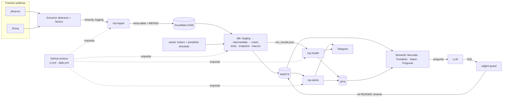
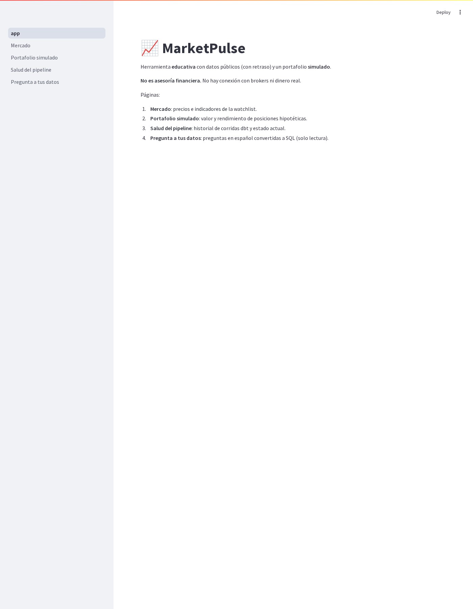
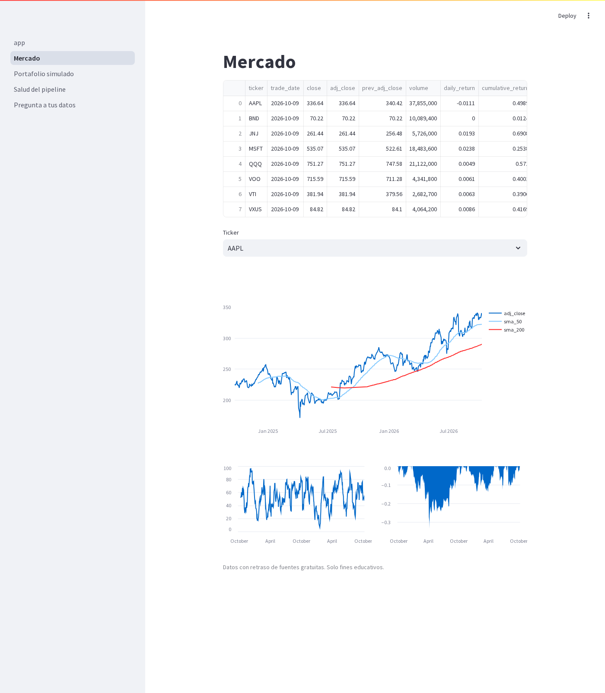
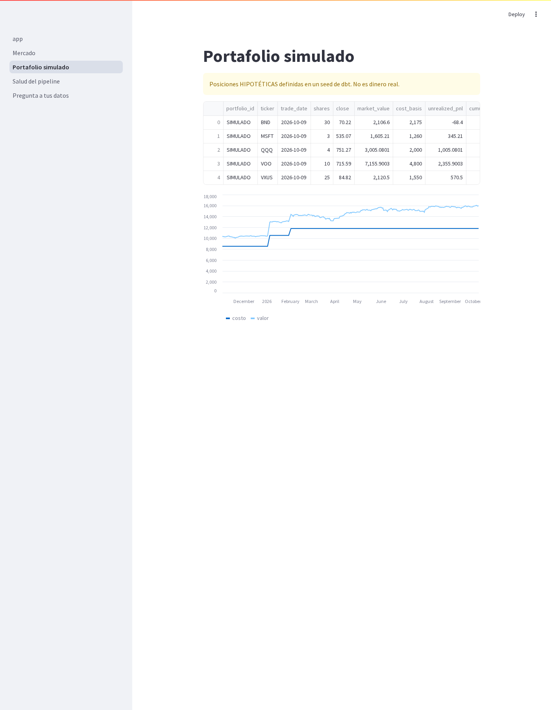
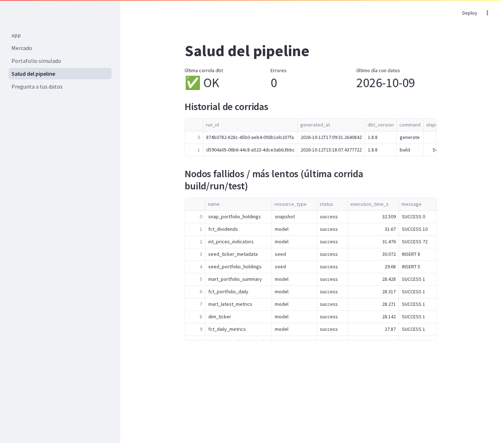

# 📈 MarketPulse

> **Versiones asumidas**: Python 3.11 · dbt-core 1.8.x (1.8.8) · dbt-snowflake 1.8.x (1.8.4) ·
> Snowflake (edición Standard o superior) · Streamlit 1.39 · sqlglot 25.x · ruff 0.6 · pytest 8.3.
> Todas fijadas en `requirements.txt` / `pyproject.toml`.

**Herramienta educativa** de ingeniería de datos sobre mercados: ingesta diaria de precios públicos a
Snowflake, métricas con dbt, alertas por Telegram, observabilidad del pipeline y preguntas en
lenguaje natural sobre los datos.

> ⚠️ **No es asesoría financiera.** Datos públicos con retraso. El portafolio es **SIMULADO**
> (posiciones hipotéticas en un seed de dbt). Sin brokers, sin dinero real.

## Módulos
| # | Módulo | Qué hace |
|---|---|---|
| 1 | Tracker | Watchlist YAML → Python (reintentos, MERGE idempotente) → RAW → dbt (staging/intermediate/marts): retornos, SMA 50/200, RSI 14, volatilidad 20/252d, drawdown, 52 semanas, portafolio simulado |
| 2 | Alertas Telegram | Movimiento diario > X %, cruce SMA 200, RSI extremo, cerca del mínimo 52s, resumen de cierre. Dedup en `OPS.ALERTS_LOG`. Redacción informativa |
| 3 | Salud del pipeline | `run_results.json` → Snowflake, frescura y volumen, alerta si falla |
| 4 | Pregunta a tus datos | Español → LLM (Cortex/OpenAI/Anthropic) → SQL validado con sqlglot → rol de solo lectura |

## Arquitectura


## Stack
Snowflake · dbt · Python (pandas, tenacity, sqlglot, exchange_calendars, yfinance) · Streamlit +
Plotly · Telegram Bot API · Docker · GitHub Actions · ruff · pytest · VS Code.

## Estructura
```
src/marketpulse/      paquete Python (layout src/, ver docs/src_layout.md)
  extractors/         interfaz PriceExtractor + yfinance + Stooq + factory
  ingestion/          mp-ingest
  alerts/             reglas, cliente Telegram, bot opcional
  health/             parser run_results.json + chequeos
  ask/                validador SQL, contexto de esquema, proveedores LLM
  dashboard/          Streamlit (4 páginas)
dbt/                  proyecto dbt (models, seeds, snapshots, macros, tests)
config/               watchlist.yaml, alerts.yaml
infra/snowflake/      SQL de setup y rol de solo lectura
tests/                pytest (seguridad SQL, reglas, extractores, health, calendario)
docs/                 un .md por tema + checklist + BotFather
.github/workflows/    ci.yml, daily.yml
```

## Cómo ejecutar
```bash
make install                      # venv + dependencias
cp .env.example .env              # rellena credenciales (no se versiona)
make lint test                    # ruff + pytest (sin Snowflake)
cp dbt/profiles.example.yml dbt/profiles.yml && make dbt-parse
# con Snowflake (tras ejecutar infra/snowflake/*.sql):
make backfill && make dbt-build && make health && make alerts
make dashboard
```
Paso a paso con resultados esperados: **[docs/checklist.md](docs/checklist.md)**.

## Decisiones técnicas
- **ELT**: Python solo extrae/carga; la lógica está en SQL versionado y testeado (dbt).
- **Extractor desacoplado** (ABC + factory por `PRICE_SOURCE`): yfinance es frágil; Stooq de respaldo.
- **Idempotencia**: temp table + `MERGE` por clave natural; lookback de 7 días para correcciones.
- **Incremental con lookback** en indicadores; métricas de historia completa en tabla (volumen pequeño).
- **Tests propios** (genéricos personalizados y singulares) sin paquetes externos: `dbt parse` offline.
- **Esquemas por entorno**: `MARTS` (prod), `DEV_MARTS`, `CI_PR_<n>_MARTS` (efímero).
- **Calendario NYSE** en código en vez de cron complejo; cron en UTC con margen para EST/EDT.
- **Seguridad LLM en capas**: validador sqlglot + rol solo lectura + timeout + SQL visible.
- **Secretos** solo en `.env` (local) y GitHub Secrets (CI).

Detalles: [arquitectura](docs/architecture.md) · [src layout](docs/src_layout.md) ·
[ingesta](docs/ingestion.md) · [dbt](docs/dbt_modeling.md) · [métricas](docs/metrics.md) ·
[alertas](docs/alerts.md) · [salud](docs/pipeline_health.md) ·
[seguridad Ask](docs/ask_your_data_security.md) · [CI/CD](docs/ci_cd_scheduling.md) ·
[Docker](docs/docker.md) · [fuentes y límites](docs/data_sources_limitations.md) ·
[conceptos de inversión](docs/conceptos_basicos_inversion.md) · [BotFather](docs/telegram_botfather.md)

## Capturas
Datos reales (target dev, cierre 2026-10-09).

**Portada**


**Mercado**: tabla de métricas, precio ajustado con SMA 50/200, RSI 14 y drawdown.


**Portafolio simulado**: posiciones hipotéticas, valor vs costo.


**Salud del pipeline**: última corrida, historial y nodos más lentos.


**Pregunta a tus datos**: chat en español → SQL validado (requiere un LLM configurado).


## Crítica honesta (lo que un revisor señalaría)
- **yfinance no es oficial**: rompe sin aviso y sus términos no permiten redistribución. Para algo
  serio se necesita un proveedor con licencia. El dashboard no debería publicarse abierto con estos datos.
- **RSI simplificado**: usamos medias simples (Cutler), no el suavizado de Wilder; los valores difieren
  de TradingView/brokers. Y RSI/SMA tienen poder predictivo discutible: aquí son ejercicio de SQL.
- **Volatilidad × √252** asume retornos independientes y normales; subestima eventos extremos.
- **Portafolio simulado simplista**: sin comisiones, impuestos, divisa (USD vs CRC), aportes ni
  reinversión. `cumulative_return` depende de la fecha de inicio de los datos.
- **LLM → SQL** puede dar respuestas plausibles pero erróneas; el validador evita daño, no errores
  lógicos. Enviar el esquema a un tercero (OpenAI/Anthropic) puede no ser aceptable en una empresa.
- **Validador por allowlist de nodos sqlglot**: depende de cómo sqlglot parsea Snowflake; la garantía
  real es el rol de solo lectura. Un SELECT costoso aún consume créditos hasta el timeout.
- **Push-only vs bot con polling**: el diseño principal es push (sin servidor). El bot interactivo
  necesita un proceso 24/7; si se despliega, mejor webhook serverless. Mantener ambos es complejidad extra.
- **Costo de Snowflake**: cada corrida despierta el warehouse (mínimo 60 s facturados por resume). El
  dashboard con caché de 10 min ayuda, pero un dashboard público podría mantenerlo encendido. Usa un
  resource monitor. Para un proyecto personal, DuckDB/MotherDuck sería más barato.
- **Contraseña en vez de key-pair** en el ejemplo por simplicidad; Snowflake está retirando la
  autenticación solo con contraseña para usuarios de servicio: migra a key-pair.
- **`fct_daily_metrics` es full refresh**: correcto con este volumen; no escala a miles de tickers.
- **Watchlist duplicada** (YAML para Python y seed para dbt): hay un test que detecta tickers de
  holdings sin precios, pero no una sincronización automática.
- **Sin tests de integración** contra Snowflake real en pytest; se apoya en `dbt build` en CI.

## Estado verificado (12-oct-2026, cuenta trial)
Ingesta real (8 tickers, ~2 años: 4112 precios, 84 dividendos), `dbt build` 52/52 PASS, health en OPS,
rol lector verificado, dashboard cargando las 4 páginas. Cortex **no** disponible en trial.

## Licencia
MIT. Datos de terceros sujetos a sus propios términos.
