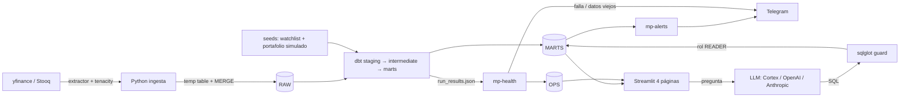

# Arquitectura

## Qué es
MarketPulse es un pipeline ELT batch diario con cuatro módulos sobre Snowflake:

1. **Tracker**: Python descarga precios → `RAW` → dbt calcula métricas → `MARTS`.
2. **Alertas**: Python lee `MARTS`, evalúa reglas y envía a Telegram (dedup en `OPS.ALERTS_LOG`).
3. **Salud del pipeline**: Python carga `run_results.json` de dbt en `OPS` + chequeos de frescura/volumen.
4. **Pregunta a tus datos**: Streamlit + LLM → SQL validado → rol de solo lectura sobre `MARTS`.

## Por qué así
- **ELT, no ETL**: Python solo extrae y carga crudo; la lógica vive en SQL versionado (dbt), que es tu
  fuerte y es fácil de testear y documentar.
- **Capas RAW / STAGING / INTERMEDIATE / MARTS**: cada capa tiene una responsabilidad. Si cambia la
  fuente, solo cambia staging.
- **OPS separado**: metadatos operativos (alertas, corridas) no se mezclan con datos de negocio.
- **Batch diario**: los datos gratuitos tienen retraso; tiempo real no aporta valor aquí.

## Cómo funciona (orden diario)
`calendario → ingesta → dbt build → health → alertas` (ver `.github/workflows/daily.yml`).

## Alternativas
- Orquestador (Airflow, Dagster, Prefect) en lugar de GitHub Actions: más visibilidad y reintentos por
  tarea, pero hay que hospedarlo. Para un job diario de 2 minutos, Actions basta.
- Coalesce en lugar de dbt: tú ya lo conoces; dbt se eligió por ser open source y portable a GitHub.
- DuckDB/MotherDuck en lugar de Snowflake para costo cero.

## Cuándo reutilizar
Cualquier proyecto "API pública → warehouse → métricas → notificaciones" de baja frecuencia.
